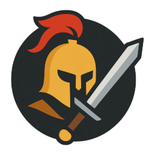
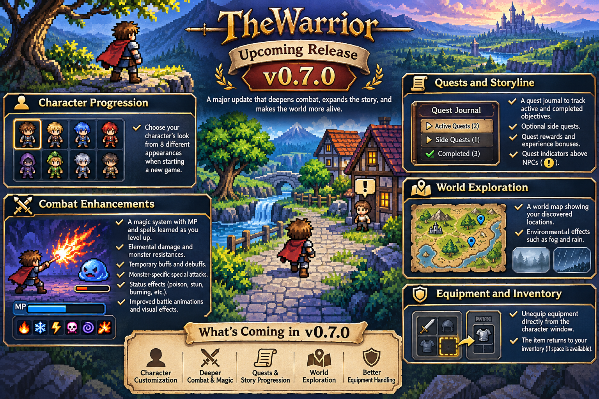
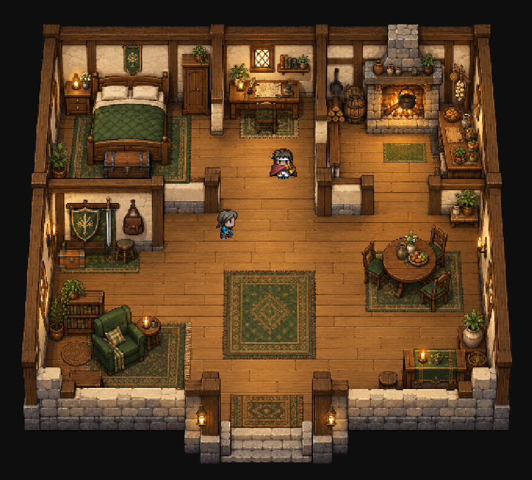
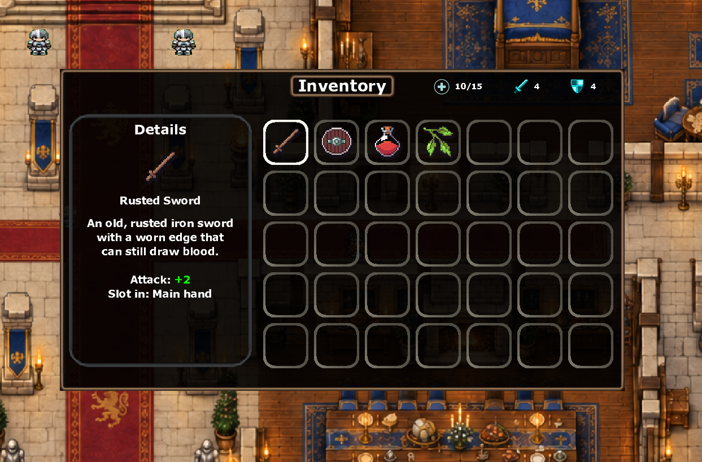
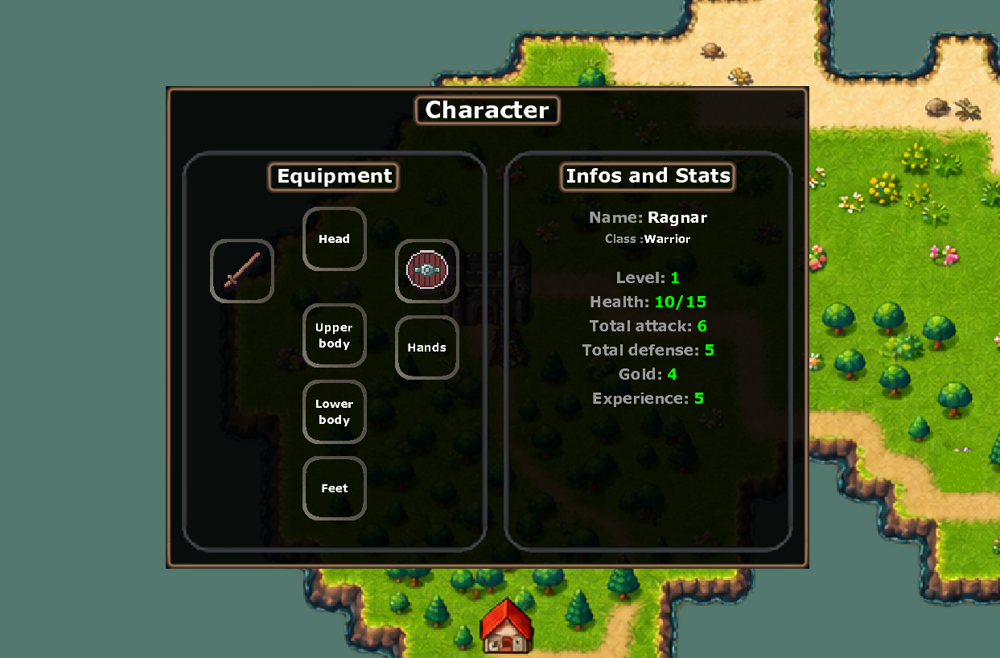
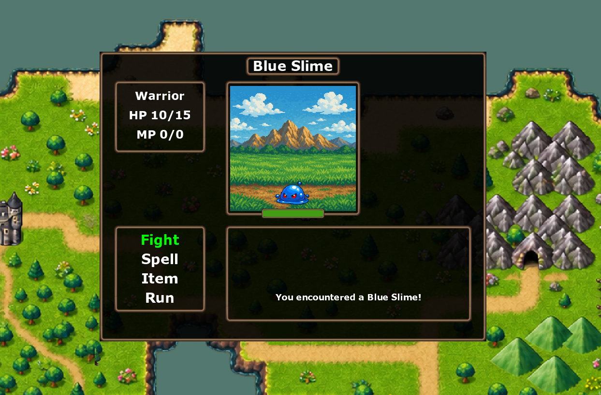
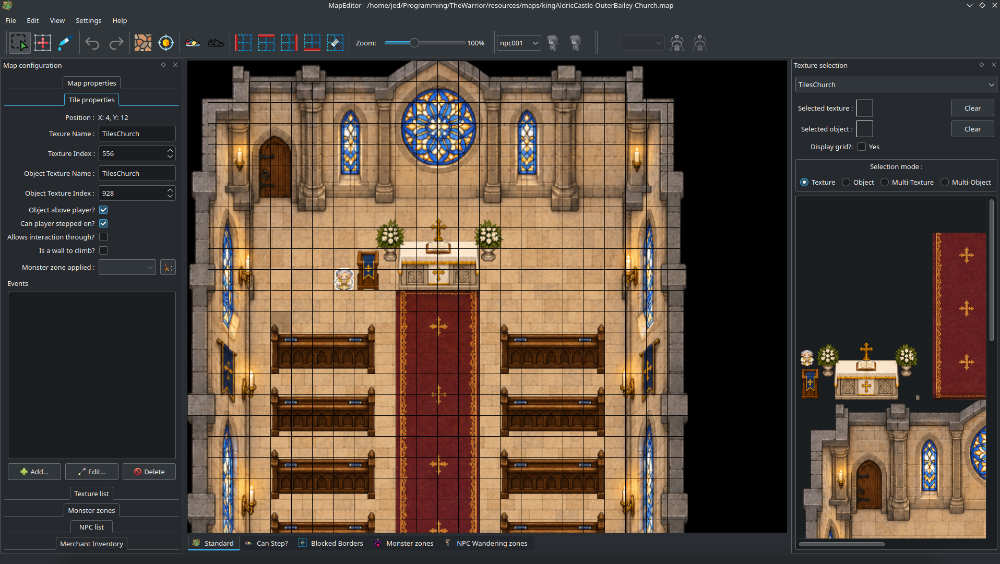
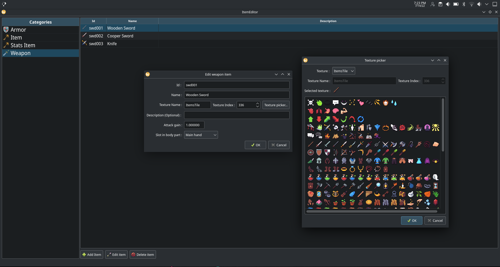
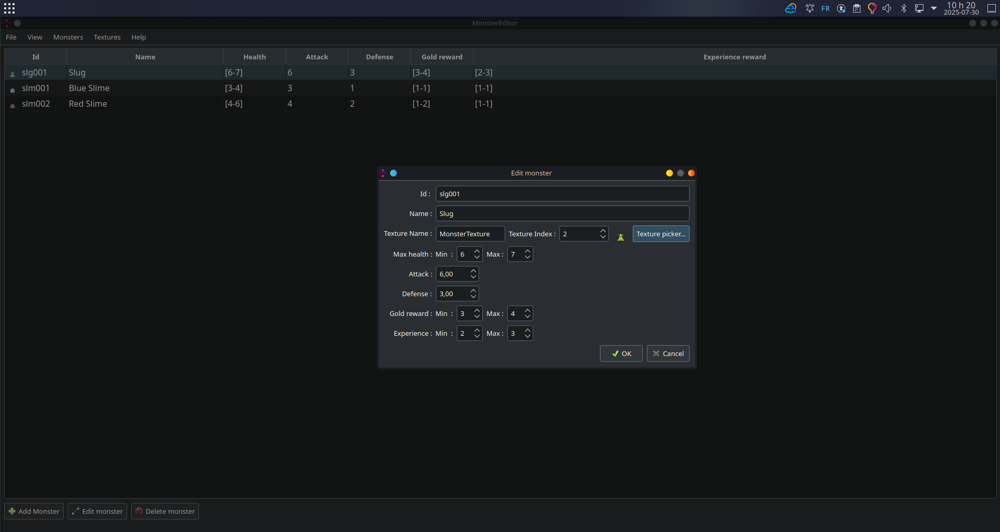

# **TheWarrior**
*A retro-inspired RPG built from scratch in modern C++*

---

## 🎮 Overview

**TheWarrior** is a handcrafted **RPG game developed in C++ using SDL2**, inspired by classic RPG mechanics while leveraging modern architecture, tools, and workflows.

The project focuses on:
- Clean, modular C++20 design
- Custom editors (Map, Items, Monsters)
- Turn-based combat
- Persistent game states
- Tooling-first development (editors before content)

> 🚧 **The game is actively developed** — v0.6.0 adds interactive NPCs, trading, story progression, and an expanded game world.

---

## 🚀 Current Version

**v0.6.0**

- NPC dialogue, branching conversations, and wandering behavior
- Merchant buying and selling, inn stays, and treasure rewards
- Saved story progression with conditional conversations and NPC visibility
- Turn-based battles with vitality items, boss encounters, and configurable encounter spacing
- Map and battle music, sound effects, and improved pixel rendering
- Expanded maps and new content authoring tools across the editors

---

## 🧭 What's New in 0.6.0

### NPCs, Trading & Story

NPCs can wander within configured zones, face the player, and take part in paginated dialogue with a typewriter effect. Branching conversations support choices, rewards, merchant shops, paid inn stays, scripted fights, and story events. Completed story IDs are saved with the game and can control conversations and NPC visibility.

### Battles & Presentation

Use vitality items on your turn, encounter bosses with their own music and victory effects, and explore with a configurable cooldown between random battles. Maps now support their own music and battle backgrounds, with music continuity across maps and after combat. New sound effects accompany combat, dialogue, inventory actions, and trading.

### World & Editors

Explore refreshed areas in Krikru Village and King Aldric's castle and outer bailey, plus the three-level North West Cave with treasures and monster zones. The Outworld map is also being expanded.

Map Editor 1.4.0 adds NPC and conversation authoring, merchant inventories, music and battle background settings, and multi-tile texture/object placement with previews and undo. The Item Editor supports default trading prices, while the Monster Editor supports boss types and battle music.

See [CHANGELOG.md](CHANGELOG.md) for the full release highlights.

---

## ✅ Development Progress

| Area | Feature | Status |
|-----|--------|--------|
| **Core Gameplay** | Game Engine | ✅ Done |
| | Combat System | 🟡 In progress |
| | NPC dialogue & wandering | ✅ Available |
| | Merchant trading & inns | ✅ Available |
| | Story & Quests | 🟡 Story progression foundation available |
| **Game Presentation** | Audio & Music | 🟡 In progress |
| | Menus & Navigation | 🟡 In progress |
| **Tools** | Item Editor | 🟡 In progress |
| | Map Editor | 🟡 In progress |
| | Monster Editor | 🟡 In progress |

Legend:
- ✅ Available
- 🟡 In progress
- ⏳ Planned

---

## What I am working on for the next release (Version 0.7.0)

## 📸 Screenshots

### 🌍 Game World — Sample Map

### 🎒 Inventory System

### 🧙 Character Window

### ⚔️ Battle System

---

## 🛠️ Tools & Editors

### 🗺️ Map Editor

### 🧾 Item Editor

### 👹 Monster Editor

---

## 🧰 Build Instructions

### 🐧 Linux

Full step-by-step instructions are available in the wiki:

👉 **[How to build TheWarrior from source on Linux](https://github.com/jeremydumais/TheWarrior/wiki/How-to-build-The-Warrior-from-source-in-Linux)**

---

## 📌 Project Philosophy

- **Tools before content**
- **Strong separation of concerns**
- **Readable, testable C++**
- **Game systems designed to scale**

This project is both a game and a long-term learning playground for engine architecture, tooling, and clean C++ design.

---

⭐ If you like the project, feel free to star it and follow development!

## Random encounter cooldown

Set `randomEncounters.minimumMovements` in `resources/gameplay.json` to the
minimum number of completed tile moves before another random encounter roll
(default: 5). The fifth move is eligible when the setting is 5; earlier moves
skip the roll entirely. Set 0 to disable the cooldown. Missing or invalid values
fall back to 5.

Random and scripted battles restart the cooldown when they start. Loading a map,
including a same-map teleport or a saved game, also restarts it. Completed moves
on all tiles count, including trigger tiles and tiles outside monster zones.
Blocked movement, menus, NPC interactions, dialogue, and combat transitions do
not advance or reset the count. The cooldown is session state and is not saved.
